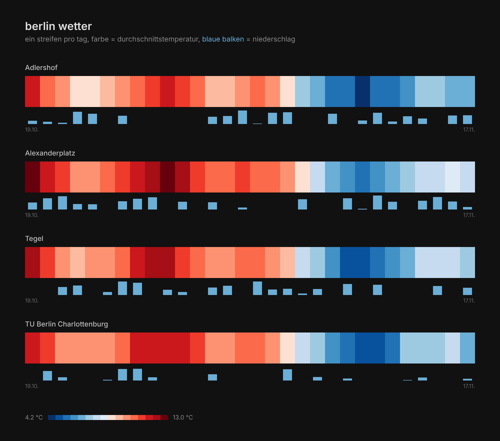
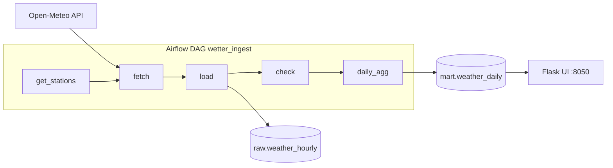

# berlin-wetter-pipeline

Kleines Data-Engineering Projekt zum Ueben mit Airflow. Ein DAG holt jeden Tag
stuendliche Wetterdaten fuer ein paar Orte in Berlin von der
[Open-Meteo API](https://open-meteo.com/) (kein API key noetig), schreibt sie in
eine Postgres DB und baut daraus eine Tagesaggregation. Die Tageswerte kann man
sich in einer kleinen Web UI als Farbstreifen anschauen.

**Live:** http://45.145.42.165:8050



*(Screenshot mit Testdaten, live sieht es je nach Wetter anders aus)*

## Was drin ist

- Airflow 2.10 mit LocalExecutor, alles in Docker Compose
- DAG mit TaskFlow API und dynamic task mapping (ein fetch task pro station)
- Upsert in Postgres, DAG kann also beliebig oft fuer den selben Tag laufen
- einfacher Datenqualitaets-Check (24 Stunden pro Station)
- raw -> mart Aggregation per SQL
- Flask UI, zeigt die Tagesdurchschnitte als "warming stripes" plus Niederschlag
- Tests fuer den DAG + GitHub Actions

## Aufbau



```
dags/wetter_ingest.py   der DAG
sql/init.sql            schema + stationen, laeuft beim ersten start vom warehouse container
sql/daily_agg.sql       raw -> mart
ui/                     flask app (gunicorn), zeigt die tageswerte als streifen
tests/                  checkt ob der DAG laedt und die tasks richtig verbunden sind
docs/                   screenshot
docker-compose.yml      airflow + 2x postgres + ui
```

Es gibt zwei Postgres Container, einen fuer die Airflow Metadaten und einen als
"warehouse" fuer die eigentlichen Daten. So kommt man nicht durcheinander.

| tabelle | inhalt |
|---|---|
| `raw.stations` | die orte mit koordinaten |
| `raw.weather_hourly` | stuendliche werte (temperatur, luftfeuchte, niederschlag, wind) |
| `mart.weather_daily` | min / max / avg temperatur, niederschlag summe usw. pro tag und station |

Stationen: TU Berlin Charlottenburg, Adlershof, Tegel, Alexanderplatz.
Neue kommen einfach per `insert` in `raw.stations` dazu.

## Lokal starten

Voraussetzung: Docker (Desktop) laeuft, mind. 4 GB RAM fuer Docker.

```bash
cp .env.example .env
docker compose up -d
```

| was | wo |
|---|---|
| Wetter UI | http://localhost:8050 |
| Airflow UI | http://localhost:8080 (admin / admin) |
| Postgres (warehouse) | `localhost:5433`, user/pw/db `wetter` |

Der DAG ist nicht pausiert und hat `catchup=True`, laeuft also direkt fuer alle
Tage ab `start_date` los. Danach jede Nacht fuer den Vortag.

## Auf einem Server (VPS)

Laeuft bei mir auf einem kleinen Debian VPS.

```bash
curl -fsSL https://get.docker.com | sh
git clone https://github.com/ahmetdogn/berlin-wetter-pipeline.git
cd berlin-wetter-pipeline
cp .env.example .env
nano .env
docker compose up -d --build
```

In der `.env` vor dem ersten Start die Passwoerter aendern, der Airflow User wird
nur beim allerersten Start angelegt. Wenn Port 8080 schon belegt ist einfach
`AIRFLOW_PORT` aendern.

Ports:

- **8050** Wetter UI, oeffentlich
- **8080** Airflow und **5433** Postgres, nur an `127.0.0.1` gebunden

An Airflow kommt man dann per SSH Tunnel:

```bash
ssh -L 8080:localhost:8080 root@SERVER_IP
```

Firewall (Docker umgeht ufw fuer veroeffentlichte Ports, deswegen das binding
an 127.0.0.1 in der compose datei):

```bash
ufw default deny incoming
ufw allow 22/tcp
ufw allow 8050/tcp
ufw enable
```

Durch `restart: unless-stopped` kommt nach einem Reboot alles von alleine wieder hoch.

## Sicherheit UI

Die UI hat keine Eingaben, die SQL Query ist fest. Trotzdem:

- Container laeuft als normaler User, read-only Dateisystem, keine Capabilities
- 256 MB RAM / 100 Prozesse Limit
- Ergebnis wird 60 Sekunden gecached, damit nicht jeder Request auf die DB geht
- gunicorn mit Timeouts und Limits fuer Request Groesse
- CSP und ein paar andere Security Header

## Daten anschauen

```bash
docker compose exec warehouse psql -U wetter -d wetter
```

```sql
select * from mart.weather_daily order by day desc, station_id;
```

## Tests

Laufen automatisch per GitHub Actions bei jedem push. Lokal in einem venv:

```bash
python3.11 -m venv .venv && source .venv/bin/activate
pip install "apache-airflow==2.10.5" apache-airflow-providers-postgres pytest --constraint https://raw.githubusercontent.com/apache/airflow/constraints-2.10.5/constraints-3.11.txt
airflow db migrate
pytest -q tests
```

## Stoppen

`docker compose down`, mit `-v` sind auch die volumes (also die daten) weg.

## TODO

- weitere stationen (vielleicht aus einer csv laden)
- tests fuer den fetch task mit gemockter API
- archive api fuer aeltere daten, forecast api geht nur ca. 3 monate zurueck
- HTTPS + domain mit caddy davor

## Lizenz

MIT
